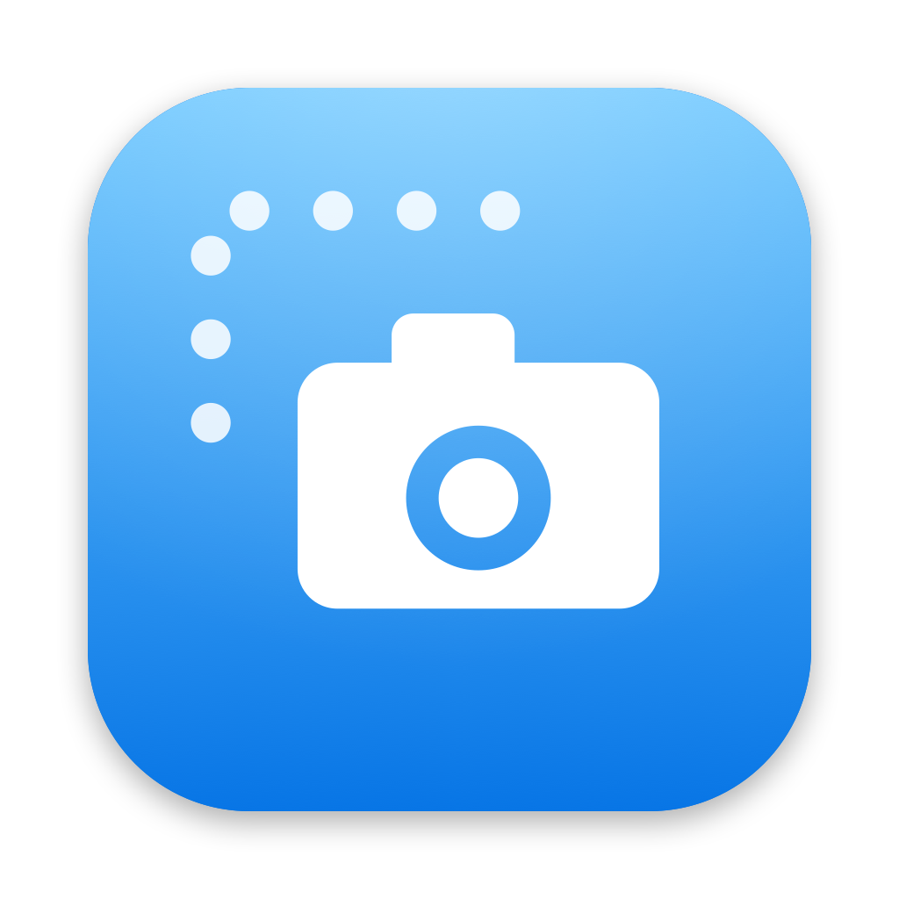

<p align="center">
  
</p>

<h1 align="center">ClearShot</h1>

<p align="center">
  Free and open-source screenshots for your Mac.<br>
  Capture an area, a window or the full screen, then mark it up in a fast, native editor.
</p>

```bash
brew install --cask austinejose1516/tap/clearshot
```

Or [download the latest DMG](https://github.com/austinejose1516/ClearShot/releases/latest).

<p align="center">
  <a href="https://github.com/austinejose1516/ClearShot/releases/latest"></a>
  
  
  <a href="LICENSE"></a>
</p>

---

## Install

ClearShot installs with [Homebrew](https://brew.sh):

```bash
brew install --cask austinejose1516/tap/clearshot
```

| To | Run |
|---|---|
| Update to the newest version | `brew upgrade --cask clearshot` (or just `brew upgrade`) |
| Uninstall | `brew uninstall --cask clearshot` |
| Uninstall and remove its settings and log | `brew uninstall --zap --cask clearshot` |

**Without Homebrew:** download `ClearShot-<version>.dmg` from the [latest release](https://github.com/austinejose1516/ClearShot/releases/latest), open it and drag ClearShot into Applications. **Check for Updates…** in the menu bar tells you when a newer DMG is out.

**First launch.**

1. The app is not notarized yet, so the first time right-click ClearShot in Applications and choose **Open**.
2. The welcome window asks for **Screen Recording** access. Click **Allow Access** and turn ClearShot on in System Settings.
3. Quit ClearShot from the menu bar and open it again. Press **⌃⇧A** to capture.

Two more permissions come up later, each only when first needed: **Microphone** (the first time the record toolbar opens with Mic on) and **Accessibility** (only for **Auto** in a scrolling capture, so ClearShot can scroll the page for you; **By hand** needs nothing).

Needs macOS 26 (Tahoe) or later. ClearShot lives in the menu bar; it has no account and keeps your screenshots on your Mac. It only talks to the network for a once-a-day check for a newer version on GitHub (Settings → Updates turns it off; **Check for Updates…** in the menu bar asks right away), and for **Upload**, which sends to your own cloud bucket and only when you press it.

## Features

### Capture

- **The bar** — **Screenshot**, **Scrolling Capture** or **Record** in the menu freezes the screen and shows a bar at the bottom, like the Mac's own ⇧⌘5 bar: pick what to make and how (**Area**, **Window** or **Full screen**), then drag, click a window or click a screen. Both choices are remembered. Space switches Area and Window, Esc cancels. Give the bar a key in Settings → Shortcuts; **Use the macOS shortcuts** makes it ⇧⌘5.
- **Area** — the screen freezes and dims; drag a box and see its size as you go. Press **Space** to switch to window mode, **Esc** to cancel.
- **Window** — hover to highlight a window, click to capture it with its shadow and rounded corners.
- **Full screen** — the display under the mouse.
- **Scrolling** — one tall screenshot of a long page. **Scrolling Capture** in the menu (then pick on the bar), or ⌃⇧S for an area (Space switches to a window). A toolbar like the record one shows at the bottom: pick **By hand** (you scroll) or **Auto** (ClearShot scrolls; needs the Accessibility permission), **Change Area**, then **Start** or Enter. The bar counts the pages and a live preview beside the area shows the tall picture growing. Auto stops at the end of the page and waits. **Done** or Enter finishes, **Esc** cancels. A sticky header or footer is kept once. The result goes through the card, clipboard, file and editor (crop it there) like any screenshot.
- Every capture flashes the screen, plays the shutter sound, goes to the clipboard and is saved to the Desktop as PNG or JPEG (change the folder and format in Settings).

### Record the screen

- **Record** in the menu (then pick on the bar), or **⌃⇧R** for an area (Space switches to a window). Nothing records yet: a toolbar shows at the bottom of the screen with **Mic** (and ▾ to pick a microphone), **Sound** (the Mac's audio), **Pointer**, **Clicks** (a ring where you click), the quality, and **Change Area** / **Change Window**. Press **Record** or Enter; Esc cancels.
- A 3-2-1 countdown, a start sound, and the toolbar turns into a bar with the time, **Pause** / **Resume** and **Stop**. The menu bar icon shows a record dot (a pause sign while paused). Stop with the bar, ⌃⇧R or **Stop** under Record in the menu (⌃⇧P pauses). ClearShot's toolbar, bar, frame and countdown never show in the video; the click rings do.
- A window is recorded as its spot on screen, so if you move the window the video does not follow.
- When you stop, the recording is saved to your folder like a screenshot and gets a card in the same row: the first frame, its length, a short "Saving" ring while it is made small, and a muted preview while the mouse is over it. The card has **Edit**, **Copy** (the file, ready to paste into Slack or Mail), **Share**, **Upload**, Reveal and Trash. The file goes to the clipboard too when "Copy to the clipboard" is on.
- **Edit** grows the card into the video editor: a filmstrip with two handles to trim, and **Done** (⌘S), which writes the trimmed cut into the recording's file. The editor shrinks back into the card, which shows the new length. Closing without Done keeps the trim while the card is open.
- Files stay small. Recordings are encoded at normal (1x) size, 30 frames per second, H.264 with a bitrate set from the picture size, so a minute of ordinary work is a few megabytes and the file plays anywhere, including in a browser. Settings → Recording has **Smaller** (default), **Better** and **Retina** (every pixel, about four times bigger).

### Quick Access card

A card slides up at the bottom-left after each capture. Hover it for a glass bar with **Edit**, **Copy**, **Share**, **Upload**, **Reveal in Finder** and **Move to Trash**, plus close and the image size. Drag the thumbnail straight into Finder, Slack or any app. Cards can close themselves after a few seconds (Settings).

### Share and upload

- **Share** (card) opens the macOS Share menu: AirDrop, Messages, Mail, Slack and whatever else is installed.
- **Upload** (card) sends the image to your own [Cloudflare R2](https://developers.cloudflare.com/r2/) bucket under a short random name, such as `images/k3x9p2m7qa.png` (recordings go to `videos/`), and copies the public link. Set it up once in Settings → Cloud: enter the Account ID, Access Key ID, Secret Access Key (kept in your Keychain), Bucket and Public URL, then press **Connect**. Connect uploads a tiny file, opens it through the Public URL and deletes it, so you know links will work. The card shows the upload progress and keeps a **Copy link** button afterwards.

### Editor

| Tool | What it does |
|---|---|
| Select | Click to select (inside shapes too), drag to move, drag a dot to resize; **⇧** keeps the proportions |
| Line | A straight line, with or without an arrowhead; **⇧** snaps it to 45° |
| Arrow | Drag to draw (**⇧** snaps to 45°); drag the middle dot anywhere to bend it, and the head follows the curve; double-click the dot to straighten it; **Both ends** puts a head at each end |
| Pen | Freehand, smoothed |
| Highlighter | A wide, see-through marker that keeps the text under it crisp; remembers its own colour and width |
| Rectangle, Ellipse | Outline or filled; **⇧** draws a square or a circle; rectangles can have rounded corners |
| Text | Drag a box to set the size, or click; type; **Enter** finishes, **⌘Enter** adds a line; bold, italic, underline and boxed styles |
| Speech bubble | Draw the bubble, type, drag its tail |
| Step number | Click to place 1, 2, 3…; pick the size or drag a corner dot |
| Blur | Pixelate or blur anything private |
| Crop | Drag the part to keep, then **Crop** or **Enter** |

- The toolbar only shows the settings that apply: colour (a dropdown with presets and any custom colour), opacity, width slider, fill, corners, arrowhead, both ends, text size, bold / italic / underline, boxed, step size, blur mode.
- A tool stays on until you press Esc or pick Select, so you can draw several shapes in a row. The shape you just drew stays selected, so colour and width changes apply to it. Over an existing shape, inside it too, the pointer takes over: drag to move it, drag a dot to resize it. Hold **⌥** to draw inside a shape instead.
- Full undo and redo. Annotations can also sit in the padding, for example a header above the screenshot. Zoom with ⌘+ / ⌘−, the zoom menu or a trackpad pinch.
- **Frame** panel: background (none, colour, 8 gradients, or your own image), padding, rounded corners and a shadow slider.
- **Edit** on a card grows the card into the editor. **Done** (⌘S) shrinks it back into the card, which shows the edited picture, says "Saved" and writes it into the same file; **Copy**, **Share** and **Upload** are on the card. Closing the editor goes back to the card too. **Edit** again brings back your drawings, still movable, while the card is open. The same goes for every kind of capture: area, window, full screen, scrolling and recordings.

### Themes and settings

- **Appearance**: System, Light or Dark, and an accent colour: Ocean, Violet, Sunset, Forest or Graphite.
- Save folder, file format, clipboard, shutter sound, mouse pointer in captures, card duration, launch at login.
- **Compress files** (on by default): much smaller files that look the same. A PNG is saved with 256 colours when that is enough, which makes a typical screenshot about a fifth of the size. If a file would still be over 1 MB, for example with a photo or the wallpaper in the picture, it is saved as a JPEG instead. The clipboard always gets the full PNG.
- **Recording**: quality (Smaller, Better, Retina), microphone (and which one), the Mac's sound, the pointer and clicks. The same switches are on the toolbar before each recording.
- **Cloud**: the Cloudflare R2 bucket that Upload sends to, with Connect / Disconnect.
- Change any shortcut, or let ClearShot take over the macOS keys **⇧⌘3 / ⇧⌘4 / ⇧⌘5** (full screen, area and the capture bar; turn the built-in ones off first in System Settings → Keyboard → Keyboard Shortcuts → Screenshots).

## Keyboard shortcuts

| Where | Keys | Action |
|---|---|---|
| Anywhere | ⌃⇧A | Capture area (Space switches to window) |
| Anywhere | ⌃⇧W | Capture window |
| Anywhere | ⌃⇧F | Capture full screen |
| Anywhere | ⌃⇧S / ⌃⌥⇧S / ⌃⇧⌘S | Scrolling capture of an area (Space switches to window) / a window / the full screen; press again to start from the toolbar, again to finish |
| Anywhere | ⌃⇧R / ⌃⌥⇧R / ⌃⇧⌘R | Record an area (Space switches to window) / a window / the full screen; press again to start from the toolbar, again to stop |
| Anywhere | ⌃⇧P | Pause or resume a recording |
| Anywhere | none until you set one | Open the capture bar (**Use the macOS shortcuts** makes it ⇧⌘5) |
| Scrolling toolbar / bar | Enter / Esc | Start, then Done / cancel |
| Record toolbar | Enter / Esc | Record / cancel (Esc also stops the countdown) |
| Video editor | ⌘S | Done: back to the card |
| Editor | ⌘Z / ⇧⌘Z | Undo / redo |
| Editor | ⌫ | Delete the selection |
| Editor | ⌘A | Select all |
| Editor | ⌘S | Done: back to the card |
| Editor | ⌘+ / ⌘− | Zoom in / out |
| Editor | Enter | Apply the crop |
| Editor | Esc | Clear the selection and go back to the pointer |
| Editor, typing text | ⌘B / ⌘I / ⌘U | Bold / italic / underline |
| Typing text | Enter / ⌘Enter | Finish / new line |

## Build from source

Needs Xcode 26+ and [XcodeGen](https://github.com/yonaskolb/XcodeGen) (`brew install xcodegen`).

```bash
make build      # generate the Xcode project and build Debug
make run        # build and launch
make core-test  # Swift Testing suite for the Core package
make check      # tests + build
make dmg        # Release build + build/ClearShot-<version>.dmg
```

`make gen` creates `Local.xcconfig` (git-ignored) for your signing settings. Follow the comments inside it once: a stable signature keeps the Screen Recording permission across rebuilds.

### Project layout

- `Packages/ClearShotCore` — the logic, with no UI: settings, capture geometry, annotations, the editor session (mouse, styling, text editing, crop), layout, undo, files. Tested with `swift test`.
- `ClearShot/` — the app: capture with ScreenCaptureKit, overlays, the Quick Access card, the editor views, settings; `Recording/` (the recorder, the toolbar, the bar, the countdown, the click rings, the video editor and exporter) and `Scrolling/` (the coordinator, toolbar and bar, live preview, scroll injector and capture session).
- `scripts/make-icon.swift` — draws the app icon (`ClearShot/Resources/AppIcon-source.png`) and the menu bar glyph (`MenuBarIcon.png`, `@2x`); `scripts/make-icns.sh` then builds `AppIcon.icns` from the source PNG.
- `~/Library/Logs/ClearShot.log` — a small diagnostics log (Settings → Show Log in Finder).

### Releasing

1. Bump `MARKETING_VERSION` in `project.yml`.
2. Push a tag such as `v0.5.0`. GitHub Actions builds and signs the DMG and publishes it as a release. Homebrew downloads that file, so keep it on the release.
3. Put the new version and DMG checksum into `Casks/clearshot.rb` in [homebrew-tap](https://github.com/austinejose1516/homebrew-tap) (a copy lives in `packaging/homebrew/`). Users then get it with `brew upgrade`.

## Contributing

Ideas, bug reports and pull requests are welcome. [Open an issue](https://github.com/austinejose1516/ClearShot/issues) to start. Please run `make check` before sending a pull request.

## Licence

[MIT](LICENSE) © 2026 Austine Jose
