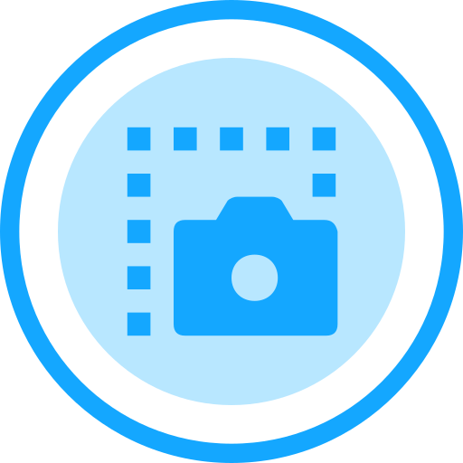

<p align="center">
  
</p>

<h1 align="center">ScreenshotXX</h1>

<p align="center">
  Free and open-source screenshots for your Mac.<br>
  Capture an area, a window or the full screen, then mark it up in a fast, native editor.
</p>

<p align="center">
  <a href="https://github.com/austinejose1516/ScreenshotXX/releases/latest"></a>
</p>

<p align="center">
  <a href="https://github.com/austinejose1516/ScreenshotXX/releases/latest"></a>
  
  
  <a href="LICENSE"></a>
</p>

---

## Install

**Download.** Get the latest `ScreenshotXX-<version>.dmg` from [Releases](https://github.com/austinejose1516/ScreenshotXX/releases/latest). Open it and drag ScreenshotXX to Applications.

**Homebrew.**

```bash
brew install --cask austinejose1516/tap/screenshotxx
```

**First launch.**

1. The app is not notarized yet, so the first time right-click ScreenshotXX in Applications and choose **Open**.
2. The welcome window asks for **Screen Recording** access. Click **Allow Access** and turn ScreenshotXX on in System Settings.
3. Quit ScreenshotXX from the menu bar and open it again. Press **⌃⇧A** to capture.

Needs macOS 26 (Tahoe) or later. ScreenshotXX lives in the menu bar; it has no account, sends nothing over the network, and keeps your screenshots on your Mac.

## Features

### Capture

- **Area** — the screen freezes and dims; drag a box and see its size as you go. Press **Space** to switch to window mode, **Esc** to cancel.
- **Window** — hover to highlight a window, click to capture it with its shadow and rounded corners.
- **Full screen** — the display under the mouse.
- Every capture flashes the screen, plays the shutter sound, goes to the clipboard and is saved as PNG or JPEG.

### Quick Access card

A card slides up at the bottom-left after each capture. Hover it for a glass bar with **Edit**, **Copy**, **Reveal in Finder** and **Move to Trash**, plus close and the image size. Drag the thumbnail straight into Finder, Slack or any app. Cards can close themselves after a few seconds (Settings).

### Editor

| Tool | What it does |
|---|---|
| Select | Click to select (inside rectangles and ellipses too), drag to move, drag a dot to resize |
| Line, Arrow | Straight lines, with or without an arrowhead |
| Curved arrow | Drag, then bend it with the middle dot; the head follows the curve |
| Pen | Freehand, smoothed |
| Rectangle, Ellipse | Outline or filled; rectangles can have rounded corners |
| Text | Drag a box to set the size, or click; type; **Enter** finishes, **⌘Enter** adds a line; bold and boxed styles |
| Speech bubble | Draw the bubble, type, drag its tail |
| Step number | Click to place 1, 2, 3…; pick the size or drag a corner dot |
| Blur | Pixelate or blur anything private |
| Crop | Drag the part to keep, then **Crop** or **Enter** |

- The toolbar only shows the settings that apply: colour (presets or any custom colour), opacity, width slider, fill, corners, arrowhead, text size, bold, boxed, step size, blur mode.
- Shape and text tools hand back to the pointer after one use, so you can adjust right away. Pen, Step and Blur stay on.
- Full undo and redo. Annotations can also sit in the padding, for example a header above the screenshot.
- **Frame** panel: background (none, colour, 8 gradients, or your own image), padding, rounded corners and a shadow slider.
- **Save** writes back into the screenshot file and closes the editor; **Save As…** writes a new PNG or JPEG; **Copy** puts the result on the clipboard and closes.

### Themes and settings

- **Appearance**: System, Light or Dark, and an accent colour: Ocean, Violet, Sunset, Forest or Graphite.
- Save folder, file format, clipboard, shutter sound, mouse pointer in captures, card duration, launch at login.
- Change any shortcut, or let ScreenshotXX take over the macOS keys **⇧⌘3 / ⇧⌘4 / ⇧⌘5** (turn the built-in ones off first in System Settings → Keyboard → Keyboard Shortcuts → Screenshots).

## Keyboard shortcuts

| Where | Keys | Action |
|---|---|---|
| Anywhere | ⌃⇧A | Capture area (Space switches to window) |
| Anywhere | ⌃⇧W | Capture window |
| Anywhere | ⌃⇧F | Capture full screen |
| Editor | ⌘Z / ⇧⌘Z | Undo / redo |
| Editor | ⌫ | Delete the selection |
| Editor | ⌘A | Select all |
| Editor | ⌘C | Copy the result and close |
| Editor | ⌘S / ⇧⌘S | Save and close / Save As… |
| Editor | ⌘+ / ⌘− | Zoom in / out |
| Editor | Enter | Apply the crop |
| Editor | Esc | Clear the selection and go back to the pointer |
| Typing text | Enter / ⌘Enter | Finish / new line |

## Build from source

Needs Xcode 26+ and [XcodeGen](https://github.com/yonaskolb/XcodeGen) (`brew install xcodegen`).

```bash
make build      # generate the Xcode project and build Debug
make run        # build and launch
make core-test  # Swift Testing suite for the Core package
make check      # tests + build
make dmg        # Release build + build/ScreenshotXX-<version>.dmg
```

`make gen` creates `Local.xcconfig` (git-ignored) for your signing settings. Follow the comments inside it once: a stable signature keeps the Screen Recording permission across rebuilds.

### Project layout

- `Packages/ScreenshotXXCore` — the logic, with no UI: settings, capture geometry, annotations, the editor session (mouse, styling, text editing, crop), layout, undo, files. Tested with `swift test`.
- `ScreenshotXX/` — the app: capture with ScreenCaptureKit, overlays, the Quick Access card, the editor views, settings.
- `scripts/make-icns.sh` — builds the app icon from `ScreenshotXX/Resources/AppIcon-source.png`.
- `~/Library/Logs/ScreenshotXX.log` — a small diagnostics log (Settings → Show Log in Finder).

### Releasing

1. Bump `MARKETING_VERSION` in `project.yml`.
2. Push a tag such as `v0.2.0`. GitHub Actions builds and signs the DMG and publishes the release.
3. Put the new DMG checksum into `Casks/screenshotxx.rb` in [homebrew-tap](https://github.com/austinejose1516/homebrew-tap) (a copy lives in `packaging/homebrew/`).

## Contributing

Ideas, bug reports and pull requests are welcome. [Open an issue](https://github.com/austinejose1516/ScreenshotXX/issues) to start. Please run `make check` before sending a pull request.

## Licence

[MIT](LICENSE) © 2026 Austine Jose
